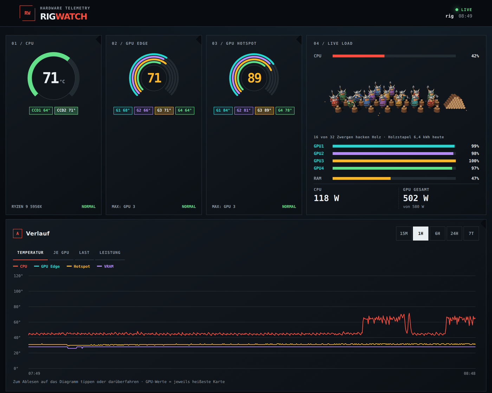
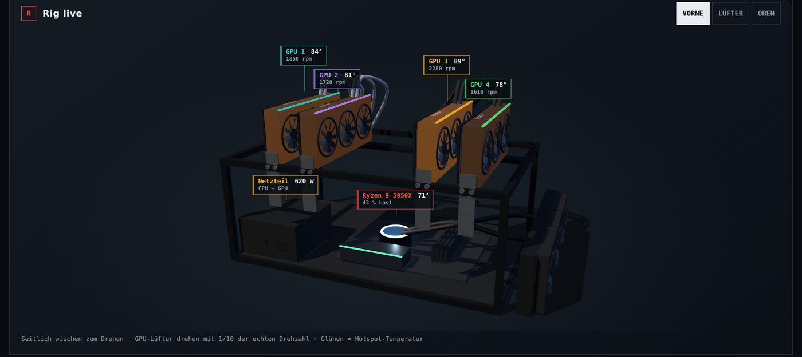
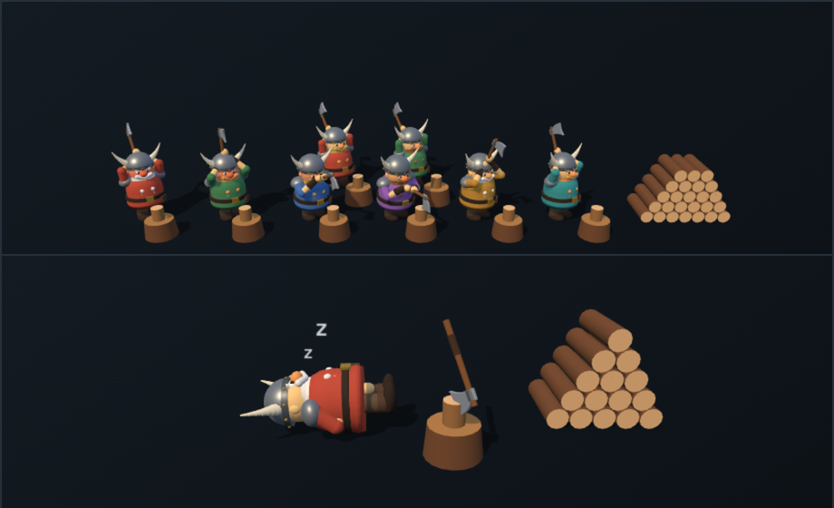
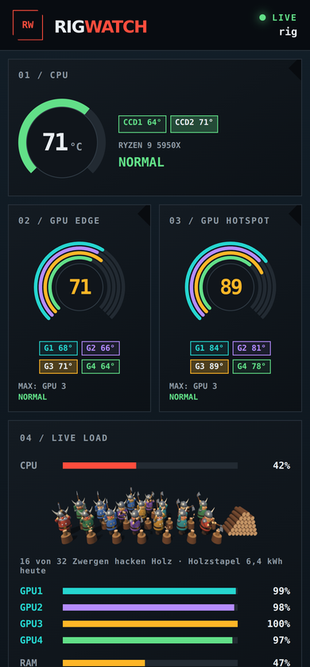
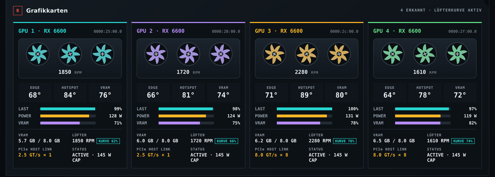

# RigWatch

A self-hosted hardware dashboard for multi-GPU Linux rigs (AI, rendering, mining),
made for the phone in your pocket as much as for the desktop.

- **Live telemetry** every 2 seconds: CPU temperature per chiplet, load per thread,
  RAM, disks, network, Docker containers, top processes
- **Every AMD GPU**: edge / hotspot / VRAM temperatures, load, power, fan speed,
  VRAM use and the PCIe link the card actually got
- **Fan curve that works**: RX 6000-series cards idle with their fans off and the
  firmware can be slow to react under load. The optional fan control takes over
  from 50 °C and gives the cards back to the firmware when they cool down
- **Energy and cost**: today, last 24 h and last 7 days at your price per kWh
- **History**: 7 days in SQLite, charts for temperatures, per-GPU hotspot, load and power
- **Your rig in 3D**: fans spin with the measured RPM, cards glow with their hotspot temperature
- **A dwarf for every busy CPU thread**, chopping wood as fast as the thread works.
  They sweat above 70 %, turn red above 90 %, and the wood pile grows with today's
  energy use. When nothing runs, one of them takes a nap.
- Optional **shutdown button** and **Wake-on-LAN**
- No build step and nothing to `pip install`: Python 3 standard library on the
  server, plain HTML/CSS/JS in the browser, Three.js bundled. Nothing leaves your network.



| Your rig in 3D | Phone |
| --- | --- |
|   |  |



> The screenshots show demo values. The dashboard is currently in German.

## Requirements

- Linux with systemd
- Python 3.8 or newer
- AMD GPUs using the `amdgpu` driver (NVIDIA is not supported yet; CPU, RAM,
  disk and everything else works without any GPU)
- Recommended: `pciutils` (GPU names) and `util-linux` (`lsblk`, usually installed)

## Install

```bash
git clone https://github.com/pelemen74-hash/rigwatch.git
cd rigwatch
sudo ./install.sh
```

Then open `http://<your-machine>:3000` on any device in your network.

The dashboard runs as the user who owns the folder, not as root. Pick extras with options;
run the installer again at any time to change them:

| Option | What it does |
| --- | --- |
| `--fan-control` | Fan curve for all `amdgpu` cards (runs as root, see below) |
| `--power-off` | Shutdown button in the dashboard |
| `--wol enp3s0` | Keep Wake-on-LAN enabled on that network card (`ip link` lists them) |
| `--port 8080` | Listen on another port |

```bash
sudo ./install.sh --fan-control --power-off --wol enp3s0
```

`sudo ./uninstall.sh` removes the services. Your `config.json` and history in `data/` stay.

To just try it without installing anything: `python3 server.py --port 3000`.

## Configuration

`install.sh` creates `config.json` from [`config.example.json`](config.example.json).
Restart after editing: `sudo systemctl restart rigwatch rigwatch-fan`.

```jsonc
{
  "host": "0.0.0.0",
  "port": 3000,
  "power_off": {
    "enabled": false,      // set by install.sh --power-off
    "token": ""            // a password the shutdown dialog asks for; empty = none
  },
  "rig": {                 // labels printed on the 3D model, empty = none
    "psu_name": "",        // e.g. "HX1200"
    "gpu_brand": "",       // e.g. "XFX" (also draws the X on the fan hubs)
    "board_label": "",     // e.g. "GAMING PRO"
    "radiator_label": ""   // e.g. "CORSAIR"
  },
  "fan_curve": {
    "start": 50,           // take over at this temperature (°C)
    "release": 42,         // hand back to the firmware below this
    "points": [[50, 35], [65, 50], [75, 70], [82, 85], [88, 100]]   // [°C, fan %]
  }
}
```

The fan curve follows the hotter of the hotspot and VRAM + 8 °C. Fans speed up at once
and slow down gently (3 % per 2 s) so they don't pump up and down.

## Wake-on-LAN

Enable Wake-on-LAN in the BIOS/UEFI, install with `--wol <interface>`, then wake the
machine from any other computer in the same network:

```bash
python3 wake.py 00:11:22:33:44:55 --broadcast 192.168.1.255
```

## Security

RigWatch has no login. Run it in your home network only, never expose it to the
internet directly. Use a VPN (WireGuard, Tailscale) to check on your rig from outside.

The shutdown button is off by default. If you switch it on, consider setting
`power_off.token`. The dashboard itself cannot shut anything down: it only drops a
request file, and a separate root unit (`rigwatch-poweroff.path`) does the shutdown.

## Fan control: use at your own risk

The fan control writes to the `amdgpu` sysfs interface as root. If the service stops or
crashes, every card is handed back to its own firmware control. It has run on four
RX 6600 cards, but every card and cooler is different: watch your temperatures after
installing, and tune the curve to your cards.

## How it works

```
server.py        HTTP server and collector (sysfs, /proc, lsblk, docker) → SQLite in data/
fancontrol.py    fan curve daemon, writes data/fan_state.json for the dashboard
static/          the dashboard: app.js, rig3d.js (3D rig), dwarves.js (the crew)
install.sh       systemd units for all of the above
```

The 3D view is modelled after an open mining frame with the cards on the top rail.
The cards are built from what the server detects, so 1 or 8 cards both work.

## Credits

- [Three.js](https://threejs.org) (MIT), bundled in `static/vendor/`

## License

[MIT](LICENSE)
